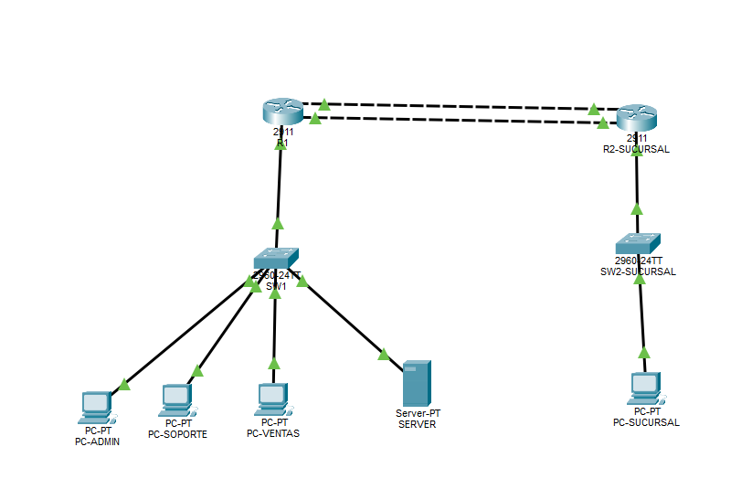
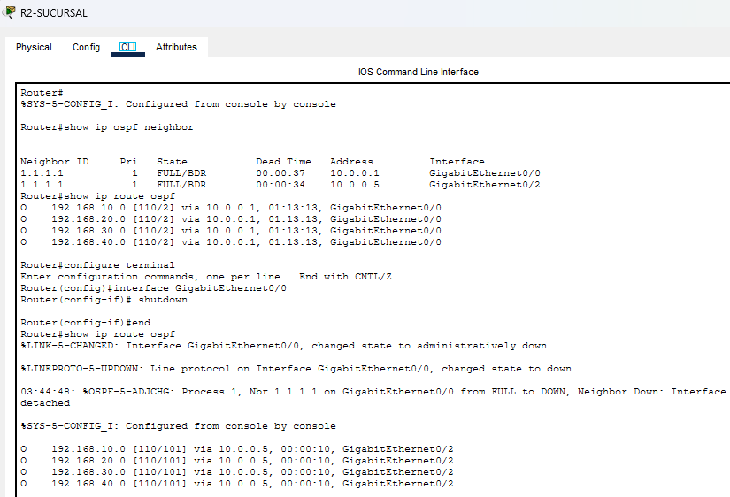
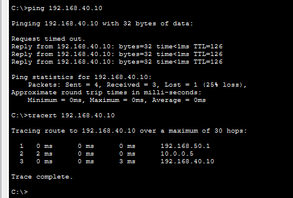
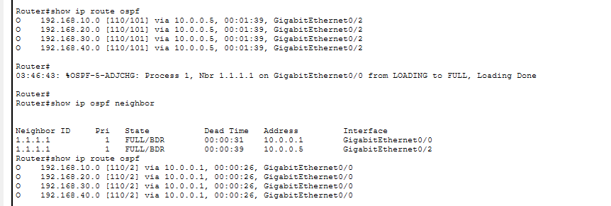

# Red empresarial segmentada con OSPF entre sedes en Cisco Packet Tracer

Proyecto personal orientado a practicar fundamentos de redes mediante el diseño y configuración de una red empresarial segmentada utilizando Cisco Packet Tracer.

La red fue dividida en diferentes áreas mediante VLANs y se implementó routing inter-VLAN, DHCP y una ACL para controlar la comunicación entre segmentos.

Una sucursal accede al servidor de la sede principal mediante dos enlaces entre routers. OSPF selecciona el camino de menor costo y cambia al respaldo cuando falla el principal.

## Tecnologías y conceptos

- Cisco Packet Tracer
- IPv4
- Subnetting
- VLANs
- Trunking 802.1Q
- Router-on-a-Stick
- Routing inter-VLAN
- DHCP
- ACL
- OSPF en área 0 y redundancia de enlaces
- Troubleshooting de conectividad

## Topología

La sede principal reúne el router R1, el switch SW1, tres PCs y un servidor. La sucursal cuenta con R2, el switch SW2 y una PC. Dos enlaces independientes conectan R1 y R2.



## Direccionamiento

| VLAN | Área | Red | Gateway |
|---|---|---|---|
| 10 | Administración | 192.168.10.0/24 | 192.168.10.1 |
| 20 | Soporte | 192.168.20.0/24 | 192.168.20.1 |
| 30 | Ventas | 192.168.30.0/24 | 192.168.30.1 |
| 40 | Servidores | 192.168.40.0/24 | 192.168.40.1 |

La LAN de la sucursal utiliza `192.168.50.0/24` y su gateway es `192.168.50.1`.

El servidor utiliza una dirección IP estática:

```text
192.168.40.10
```

## VLANs

Se configuraron cuatro VLANs en el switch:

```text
VLAN 10 → ADMIN
VLAN 20 → SOPORTE
VLAN 30 → VENTAS
VLAN 40 → SERVIDORES
```

Cada dispositivo fue asignado a un puerto de acceso correspondiente a su área.

## Trunk 802.1Q

El enlace entre el switch y el router fue configurado como trunk para transportar tráfico perteneciente a múltiples VLANs.

```text
SW1 Gi0/1
     |
     | 802.1Q
     |
R1 Gi0/0
```

## Routing inter-VLAN

Se utilizó la técnica Router-on-a-Stick.

Sobre una única interfaz física del router se crearon diferentes subinterfaces:

```text
G0/0.10 → 192.168.10.1
G0/0.20 → 192.168.20.1
G0/0.30 → 192.168.30.1
G0/0.40 → 192.168.40.1
```

Esto permite que dispositivos pertenecientes a diferentes VLANs puedan comunicarse mediante el router.

## DHCP

R1 fue configurado como servidor DHCP para las VLANs de usuarios.

Se crearon pools independientes para:

```text
ADMIN
SOPORTE
VENTAS
```

Las PCs de Administración, Soporte y Ventas reciben automáticamente:

- dirección IPv4
- máscara de subred
- gateway predeterminado
- servidor DNS

El servidor de la VLAN 40 mantiene una dirección IP estática.

## ACL

Se implementó una ACL extendida para controlar el tráfico entre las VLANs.

La política configurada restringe el tráfico originado desde la red de Ventas hacia la red de Administración:

```text
VENTAS
192.168.30.0/24
      |
      X
      |
ADMINISTRACIÓN
192.168.10.0/24
```

El resto del tráfico permitido por la política puede continuar circulando entre las redes.

## Pruebas realizadas

Se realizaron pruebas para comprobar:

- conectividad con los gateways
- comunicación entre VLANs
- acceso hacia la VLAN de servidores
- asignación automática mediante DHCP
- funcionamiento del trunk 802.1Q
- funcionamiento de la ACL
- restricción de tráfico entre Ventas y Administración

## Redundancia entre sedes con OSPF

| Enlace | Subred | Interfaz e IP de R1 | Interfaz e IP de R2 |
|---|---|---|---|
| Principal | `10.0.0.0/30` | G0/1 · `10.0.0.1` | G0/0 · `10.0.0.2` |
| Respaldo | `10.0.0.4/30` | G0/2 · `10.0.0.5` | G0/2 · `10.0.0.6` |

R1 y R2 forman una adyacencia OSPF por cada enlace. El costo configurado en la interfaz de respaldo es 100. Desde R2, el costo total hasta cada red de la sede principal es 2 por el enlace principal y 101 por el respaldo.

### 1. Caída del enlace principal

Antes de la falla, R2 alcanzaba las cuatro redes de R1 por `10.0.0.1`. Al ejecutar `shutdown` en G0/0 de R2, las cuatro rutas cambiaron automáticamente a `10.0.0.5` por G0/2.



### 2. Acceso al servidor por el respaldo

Con el enlace principal desactivado, PC-SUCURSAL recibió tres de cuatro respuestas al hacer ping al servidor. El recorrido de `tracert 192.168.40.10` fue `192.168.50.1 → 10.0.0.5 → 192.168.40.10`, lo que confirma el paso por el respaldo.



### 3. Recuperación del enlace principal

Tras ejecutar `no shutdown` en G0/0 de R2, la adyacencia volvió al estado `FULL`. La tabla de rutas mostró las cuatro redes nuevamente por `10.0.0.1`, con costo 2.



## Evidencias

Las capturas de configuración y pruebas se encuentran en:

```text
/screenshots
```

Incluyen:

- topología completa
- VLANs configuradas
- enlace trunk
- interfaces y gateways
- asignaciones DHCP
- ACL
- pruebas de conectividad

## Archivo de Packet Tracer

El laboratorio completo se encuentra en:

```text
/packet-tracer/enterprise-network.pkt
```

## Resultado

La sede principal cuenta con cuatro VLANs, asignación DHCP para las PCs de usuarios y control de acceso entre Ventas y Administración. La prueba entre sedes verificó el acceso al servidor por el enlace de respaldo y el retorno automático al enlace de menor costo al recuperarse el principal.
